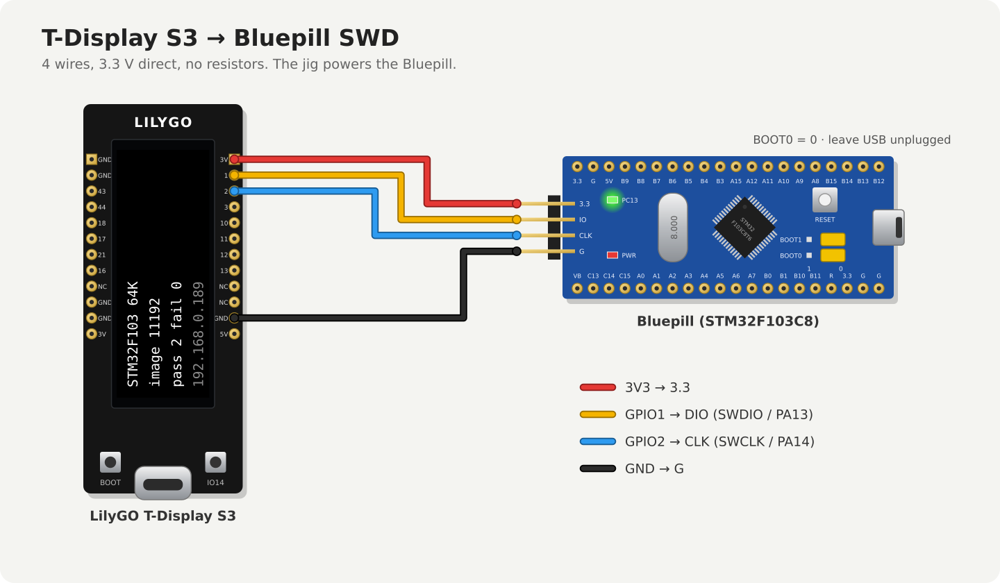

# TDisplayS3-STM32F1-Flasher

Standalone production flasher for STM32F103 boards, developed against a
**Bluepill** (STM32F103C8T6): a LilyGO T-Display S3 (ESP32-S3) programs the
target over SWD — no PC, no ST-Link. Same jig model as
[TDisplayS3-STM8S-Flasher](https://github.com/holla2040/TDisplayS3-STM8S-Flasher):
firmware image uploaded over WiFi and stored on the jig, auto mode flashes each
board once, PASS/FAIL on the display.

## Wiring

3.3 V, direct connection to the Bluepill's 4-pin SWD header:



| T-Display S3 | Bluepill SWD header |
|---|---|
| GPIO 1 | DIO (SWDIO / PA13) |
| GPIO 2 | CLK (SWCLK / PA14) |
| GND | GND |
| 3V3 | 3.3 — the jig powers the board |

No resistors needed (PA13 has an internal pull-up). NRST isn't on the SWD
header, so the jig resets the target with SYSRESETREQ over SWD. Leave BOOT0 at 0.

Buttons: GPIO0 (BOOT) toggles auto/manual, held at power-up resets WiFi.
GPIO14 (KEY) flashes in manual mode.

## Build and deploy

arduino-cli + esp32 core 3.x + TFT_eSPI (`Setup206_LilyGo_T_Display_S3`):

```
make bin       # compile into /tmp/arduino-build-stm32
make usb       # upload over /dev/ttyACM0
make ota       # upload over WiFi to STM32Flasher.local
```

First boot opens a WiFiManager AP named `STM32Flasher`; afterwards the jig is
at `http://STM32Flasher.local/`.

## Loading the target firmware

A raw `.bin` linked at 0x08000000 (what an Arduino STM32 build produces as
`<sketch>.ino.bin`) or an Intel HEX file. Any of:

```
make image IMG=path/to/app.ino.bin
curl -F image=@app.ino.bin http://STM32Flasher.local/upload
# or the upload form at http://STM32Flasher.local/
```

The image must have a sane Cortex-M vector table (SP in SRAM, reset vector
inside the image) before it replaces the stored one — a wrong file (e.g. the
flasher's own `.ino.bin`) is rejected.

## What a flash does

SWD attach → halt + reset with vector catch (core stops before the old
firmware runs) → for each 1 KB page the image covers: page erase, halfword
program → read-back verify → reset and run.

**Only the pages the image covers are erased.** Data a sketch keeps in
EEPROM-emulation pages at the top of flash (e.g. the Arduino EEPROM library)
survives a reflash.

Home line 1 is the live probe (`no target` / `STM32F103 64K`), once a second.
The probe doesn't reset or halt the board. FAIL means only a verify mismatch;
comm errors retry up to 3 times and end with an orange `comm error` notice. A
read-protected chip (RDP) shows an orange `locked` notice; clear it with an
ST-Link (`openocd ... -c "stm32f1x unlock 0"`), which mass-erases the chip.

## Status

Verified on hardware: probe, reset-halt, program and verify of a Bluepill
(STM32F103C8, IDCODE 0x1BA01477) pass end to end. See `CLAUDE.md` for the
behavior contracts.

## License

MIT — see [LICENSE](LICENSE).
